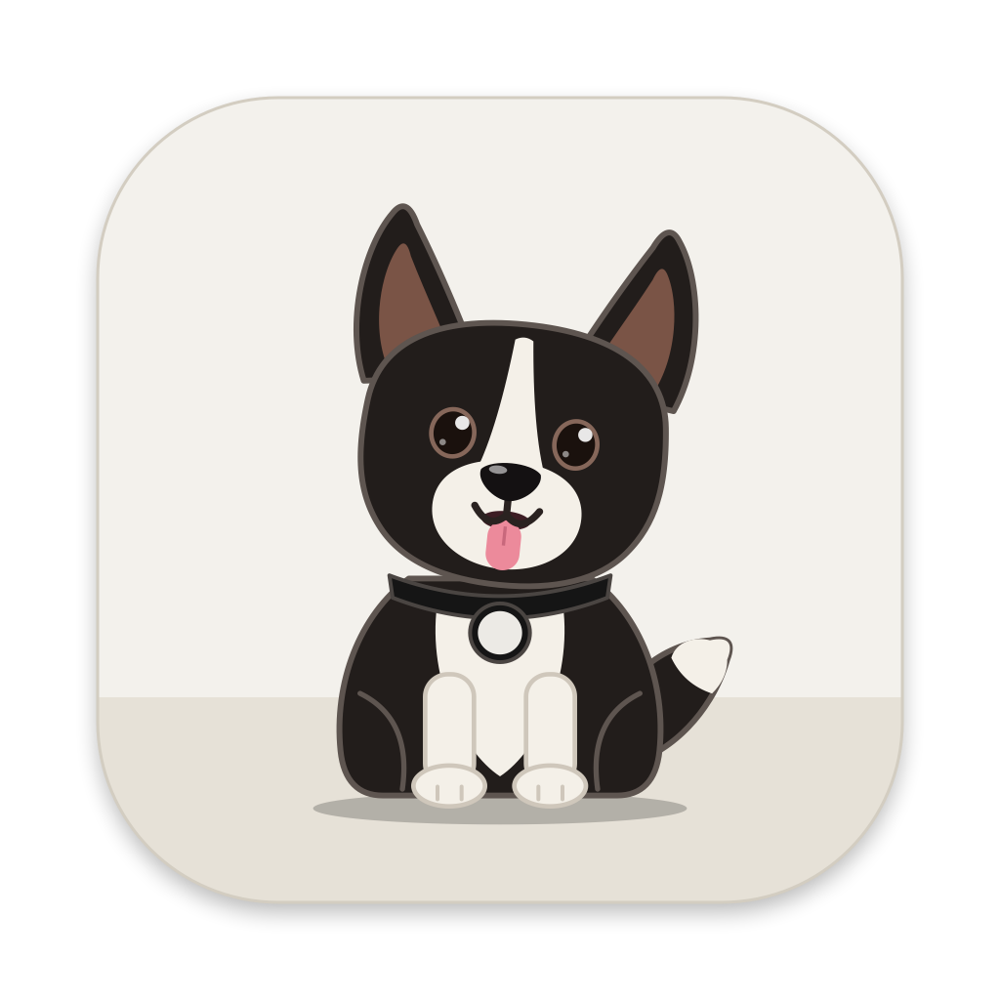
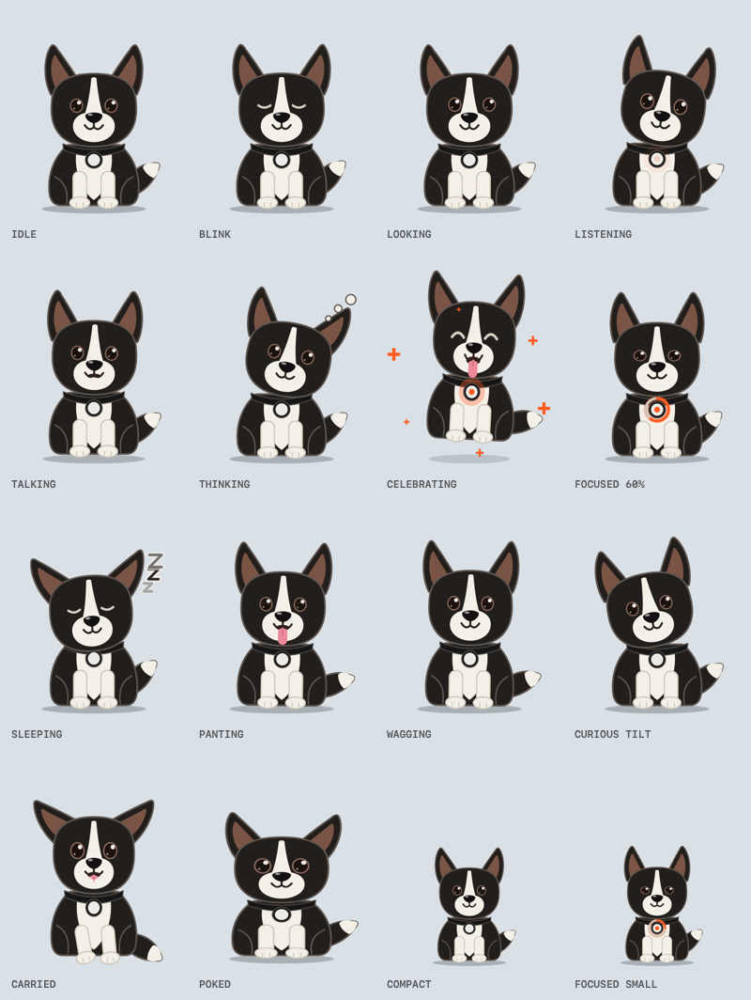
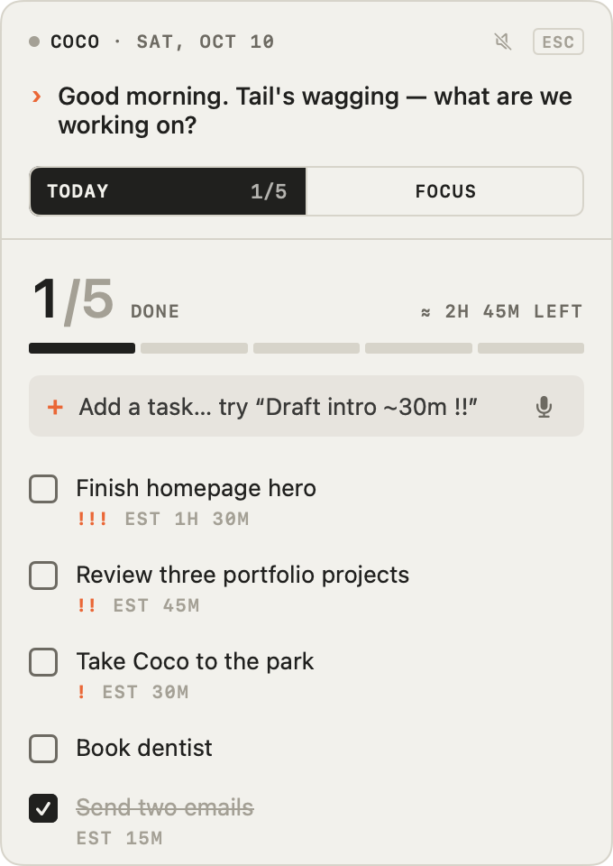
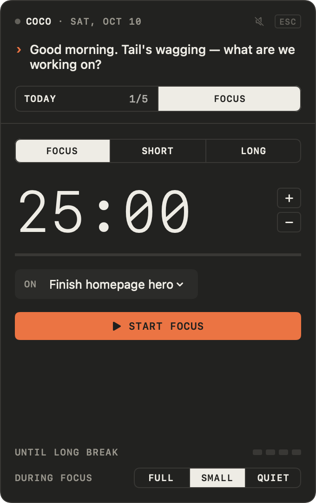
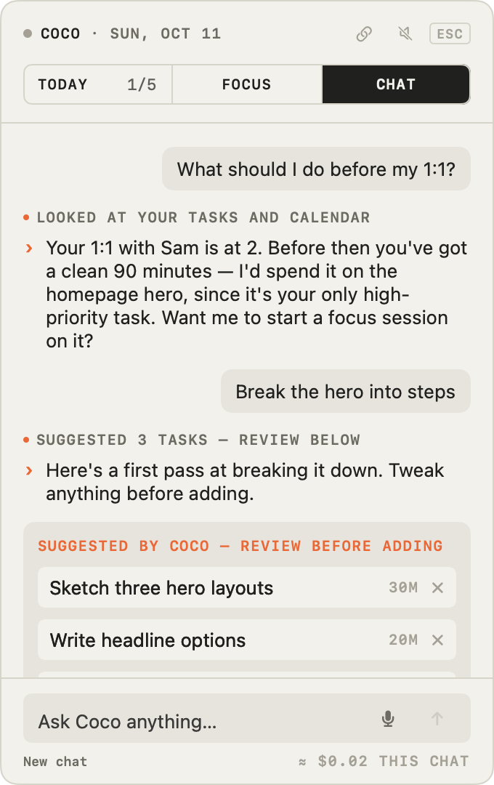
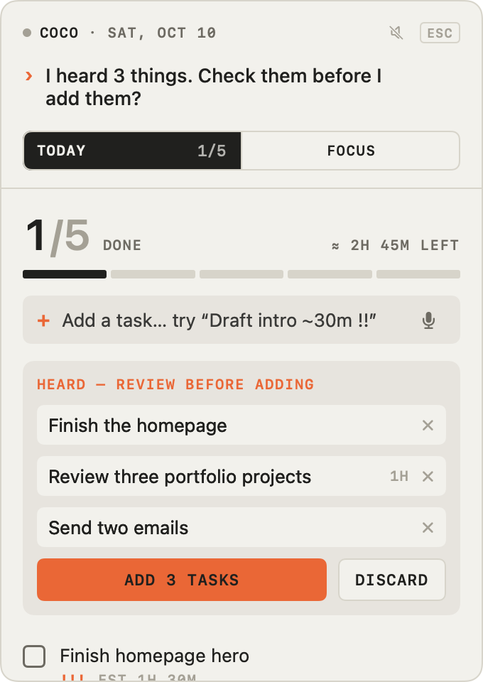
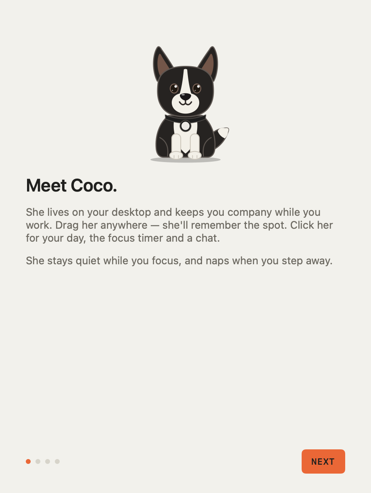
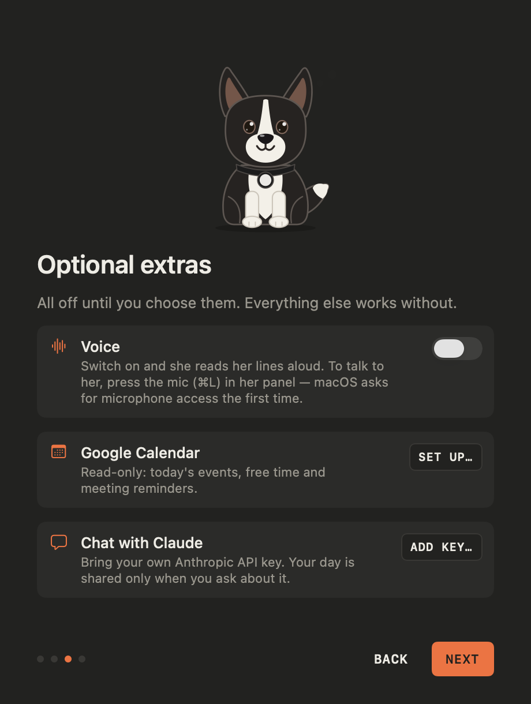
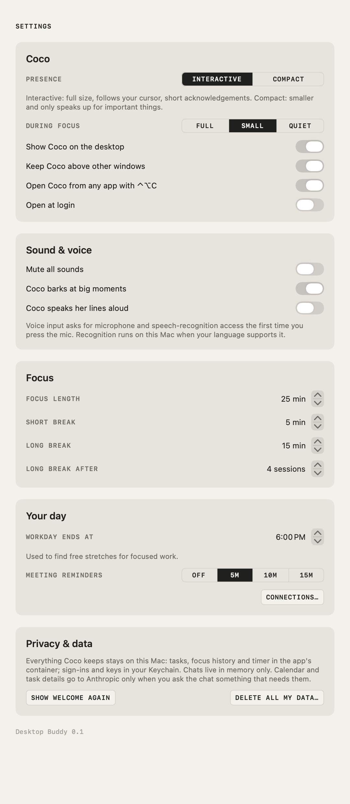
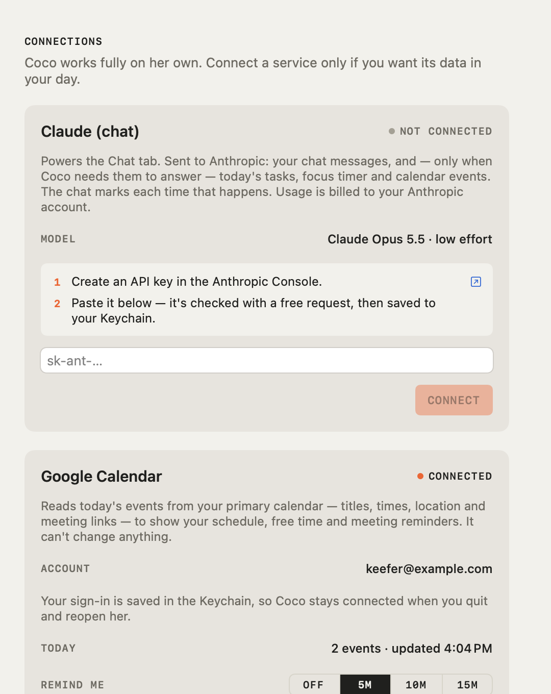

# Desktop Buddy

A native macOS desktop companion. **Coco** is a black-and-white corgi with a white blaze, giant ears and a collar tag. She sits on your desktop, keeps your daily list, runs focus sessions, listens when you talk to her, chats about your day and reacts to what you do. She's part Clippy, part virtual pet and part productivity tool, built to stay open all day without getting in the way.

<br clear="left">



| Today | Focus (dark) | Chat with Claude | Voice: review what Coco heard |
| --- | --- | --- | --- |
|  |  |  |  |

| Welcome | Optional extras, each explained first | Settings | Connections |
| --- | --- | --- | --- |
|  |  |  |  |

**Swift 6 · SwiftUI + AppKit + Core Animation · no third-party dependencies · 163 unit tests · about 1% CPU at idle**

## Highlights

- **A character, not a sprite sheet.** Coco is a few dozen Core Animation layers driven by a pure function of time: state + time + events → pose → layers. She has idle life (blinks, glances, ear flicks, wags, panting, head tilts, naps), reactions (hops, barks, celebrations) and a mouth synced to her voice and her barks.
- **Energy-aware rendering.** The animator predicts when anything will next move. Quick motion runs at 60 fps, slow rhythms at 30 fps, and at rest a single timer ticks about 10× a second. Nothing renders while she's hidden or covered.
- **Planning that stays honest.** A local task list with a quick-add syntax, *Up next* with its reason, focus sessions linked to tasks, and carry-over for today-only items. Nothing is ever marked done because time passed.
- **Talk to her.** On-device speech recognition and a tested rule-based parser. Commands run directly; everything else becomes draft tasks you review.
- **Claude, safely.** Raw HTTP + SSE to the Messages API, with narrow tools: read today and the calendar, read Partiful invites, *propose* tasks and calendar changes, start focus, and *ask* to complete a task. Adding or completing tasks always waits for your click; only a focus session (local, and stoppable) starts straight away.
- **Google Calendar.** OAuth with PKCE; a week browser with open time; meeting reminders; Coco finds free slots and adds, moves or deletes events only after you confirm (Google asks once for that permission). Tokens stay in the Keychain.
- **Apple Calendar, and one schedule.** Coco reads the calendars in Calendar.app (iCloud, Google, Exchange, On My Mac) through EventKit, read-only, after you allow it. Events from every connected calendar are merged into one schedule: a meeting that's in both Google and Apple Calendar shows once, everywhere — the Today card, the week, reminders, counts and the chat.
- **Partiful invites.** Paste a Partiful link in chat and Coco reads the event (title, time with its time zone, place, description) from the page's public schema.org data, converts it to your time zone, and offers it as an event to confirm. Missing details are asked about, never guessed; the invite link is kept on the event, and sharing it again never creates a duplicate. In **Connections › Partiful** you can also import all your Partiful events from your personal Partiful calendar link: they show in Coco's calendar and count for free time, read-only, without being copied into Google Calendar.
- **Respectful by default.** First-launch welcome, onboarding that explains each permission before macOS asks, Settings with *Delete all my data*, full keyboard use, VoiceOver labels, and support for Reduce Motion and Low Power Mode.

## Status

All five phases are done.

1. **Native desktop prototype:** floating character, drag and position memory, panel, focus timer, notifications, Coco and voice.
2. **Daily planning:**
   - tasks with notes, priority, estimate, deadline, and *my list* or *today only*;
   - a daily overview (done/remaining, focused today, time left, *Up next*);
   - a focus log.
3. **Calendars (Google and Apple):**
   - a Today card: what's on now (and how long is left), the next meeting and how soon, the rest of the day with the open time between, and *Coming up* for the next few days;
   - **Week**: the strip opens into a week you can click, drag across or step through with ←/→, each day's events in order with the open time between them;
   - meeting reminders and a focus-length heads-up.
   - Setup: [docs/INTEGRATIONS_SETUP.md](docs/INTEGRATIONS_SETUP.md).
4. **Conversational assistant:** a Chat tab with Claude (Opus 5.5, low effort, streamed replies), voice input, and tools whose task changes are confirmed in the panel.
5. **Polish:**
   - a first-launch welcome, Settings, *Delete all my data*;
   - a global shortcut (⌃⌥C), keyboard navigation of the task list, VoiceOver labels;
   - an app icon, barks, handling for day change and wake, plus a [QA checklist](docs/QA_CHECKLIST.md) and a [60-second demo script](docs/DEMO_SCRIPT.md).

**Notion is paused.** Its integration code and tests remain in `BuddyIntegrations`, switched off by `Features.notion`, so nothing in the app shows or runs it.

## Build & run

Requirements: macOS 14+, Xcode 16+ (developed with Xcode 26.5).

1. Open `DesktopBuddy.xcodeproj` and press **⌘R**.
   - The project signs with **John Keefe (Personal Team)**. If Xcode says it can't sign, open *Xcode › Settings › Accounts*, select the Apple ID and sign in again if asked, then build again. Xcode creates the development certificate automatically.
   - Stable signing matters here. macOS ties microphone and speech permissions and Keychain items to the app's signature, so an ad-hoc build would ask again after every rebuild.
2. The welcome window introduces Coco. Afterwards she sits in the bottom-right corner. The app has no Dock icon: her head in the **menu bar** is her home (Settings, Connections, Quit).

The unit tests (models, timer, voice parsing, planner, calendar maths, assistant tools, animation) run without launching the app:

```bash
cd Packages/BuddyKit && swift test
```

## Try it

| Do this | Expect |
| --- | --- |
| Hover near Coco | Her eyes follow the cursor (Interactive presence) |
| Watch for a minute | She blinks, glances around, flicks an ear, wags, pants and tilts her head, on a schedule rather than constantly |
| Drag her | Legs dangle and ears flop while carried. She squashes on landing and snaps back if dropped off-screen |
| Hold **Right ⌥** and click anywhere | A faint circle shows where she'll land. She spots it, drops into a play bow, dashes there (32 facings, blended as she turns), then turns and sits. Click again mid-run to change course |
| Hold **Right ⌘** a moment and click anywhere | A tennis ball appears under the cursor; the click throws it there. She spots it, sets off before it lands, picks it up as it settles, runs it back to where she was and drops it at her paws |
| Hold **Right ⇧** a moment | She sits up and begs, paws raised, eyes on the treat under your cursor. Click to toss it: she chases it before it lands, eats it where it falls (a bite, a few chomps, a lick) and jumps for joy |
| Click her, or press **⌃⌥C** from any app | The panel opens beside her. Type a task, e.g. `Draft homepage ~45m !!` |
| **↓** from the add field, then **↑ ↓ Space ↩ ⌫ F** | Move through tasks, tick, edit, delete, start focus on the selected one |
| Tick a task | She barks and celebrates: hops, tongue out, tail going |
| Click a task's title | Inline editor: title, notes, priority, estimate, due date, *My list* or *Today only*. Edits save as you go |
| Add `Water plants @today` | A today-only item. If it's unfinished tomorrow, Coco offers *Carry over* or *Let go*; it never just disappears |
| Look at *Up next* | One suggestion and why: overdue, then due today, due tomorrow, high priority, quick win, waiting longest. ▶ starts focus on it |
| Mic button or **⌘L**, then say *"I need to finish the homepage, review three portfolio projects for about an hour, and send two emails today"* | Ears up, head cocked, collar tag glowing while she listens. Then three editable tasks to review; nothing is added until you press **Add** |
| Say *"start focus on the homepage"*, *"pause"*, *"resume"*, *"stop"* or *"take a break"* | Runs the timer command directly |
| Start a focus session | The panel tucks away. She acknowledges once, then sits on guard; a progress ring fills around her collar tag, with a countdown under her and in the menu bar |
| Session ends | Chime, celebration and a notification. The Focus tab asks whether the task got done (it's never assumed) |
| Chat tab › *"What should I work on next?"* | Coco looks at your tasks and calendar (the chat says so) and answers briefly. She thinks while waiting and her mouth moves while the reply streams |
| Chat › *"Break my top task into steps"* | Draft tasks appear for review; nothing is added until you press Add |
| Chat › *"I finished the intro"* | A "Mark done?" card. Only your click marks it |
| Today › calendar › **Week** | The week strip: drag across the days or use ←/→ (⇧ for a week, T for today). Each day lists events and the open time between them |
| Chat › *"Find me a free hour Thursday afternoon"* | Coco checks Thursday's real events and offers openings, saying why |
| Chat › *"When's my next meeting with Sam?"* | Coco searches your calendars on the Mac (titles, places, attendees) and answers with the soonest match |
| Connections › **Apple Calendar** › *Connect* | macOS asks once for calendar access. Your calendars appear with switches; events already in Google Calendar aren't shown twice |
| Chat › *"Schedule a design review next Tuesday at 2"* | An "Add to Google Calendar" card with any clash shown. Only **Add** creates it; the first time, Google asks you to allow changes |
| Right-click her | Talk, presence, focus behaviour, always-on-top, mute, hide, reset position, Settings |
| Menu bar › Settings… | Presence, sounds and barks, focus lengths, workday end, reminders, open at login, the shortcut, *Show welcome again*, *Delete all my data* |
| Leave the Mac idle 5 min | She dozes off (airplane ears, Zs) and wakes when you return |
| `Esc` / `⌘1` `⌘2` `⌘3` / `Space` / `⌘L` / `⌘.` | Close panel / switch tabs / start-pause on Focus / talk / stop a reply |

Permissions are asked for only on first use: notifications when you first start a session, microphone and speech recognition when you first press the mic, calendars when you first connect Apple Calendar. If you decline, everything else keeps working and the panel shows where to turn them on.

## How it's built

```
DesktopBuddy/                    App target: AppKit windows + SwiftUI views only
  App/        AppModel (composition root: events → behaviour, voice intents), menus, snapshot renderer
  Windows/    CharacterPanel (floating, non-activating), BubbleWindow, InteractionPanel, hosted windows
  Character/  CocoLayerView (artwork), CharacterRenderLoop, CharacterModel, BuddyVoice (lines)
  Panel/      Today (+ voice review), Focus, Chat, Connections, Settings, Welcome, design tokens
  Services/   TaskStore, FocusController, VoiceInput/Output, calendar, assistant, notifications, sounds,
              presence, global shortcut, preferences
Packages/BuddyKit/               Pure Swift package, no UI, unit-tested
  BuddyCore         Coco's dialogue pools + line picker, tasks, quick-add parser, day planner (Up next), focus log, voice parsing, focus timer, persistence
  BuddyCharacter    States, pose model, animator (blinks, idle life, reactions, frame scheduling)
  BuddyIntegrations Google OAuth (PKCE) + Calendar parsing, Apple Calendar mapping, cross-calendar merge + search, free-time maths; Notion (paused)
  BuddyAssistant    Claude Messages API (raw HTTP + SSE), stream accumulation, tool schemas + validation, prompts
```

Everything that can be tested without a screen lives in the package; the app target is wiring and views.

**The character is three layers.**
- `CharacterState` covers idle, listening, talking, thinking, celebrating, focused and sleeping.
- `CharacterAnimator` turns state + time + events into a `CharacterPose`: plain numbers for eye openness, gaze, ear perk, tail angle, tongue, head tilt and so on.
- `CocoLayerView` draws the pose.

Animation is a pure function of time, so it's testable. Coco replaced the original placeholder robot without touching the animation system. The same view draws her in the welcome window, the snapshots and the app icon.

**Energy.** The animator predicts when anything will next move:
- Quick motion (blinks, ear flicks, reactions, hops) renders at 60 fps from a display link.
- Slow rhythmic motion (wagging, panting, listening) renders at 30 fps.
- At rest, a single timer wakes about 10× a second (6× asleep).
- Nothing renders while she's hidden or covered.

She's drawn with Core Animation layers: each frame only sets transforms and opacity, and the window server rasterises. Measured idle cost (Release build, Intel Mac) is **about 0.9% CPU and 45 MB**, including her idle life. For comparison, a SwiftUI `Canvas` renderer measured 4.4%. Reduce Motion and Low Power Mode are respected.

**Voice.**
- Input uses Apple's Speech framework, with on-device recognition whenever the language supports it.
- The mic is open only while you're talking to her. It closes after a pause, after 30 s, or when you click again.
- Transcripts go through a small, tested rule-based parser. Timer commands run directly; anything else becomes tasks to review.
- Splitting on "and" uses Apple's on-device NaturalLanguage tagger, so "finish the homepage and send emails" splits but "buy salt and pepper" doesn't.
- She answers in text (her speech bubble and the panel) with barks at big moments — she doesn't read lines aloud.
- Her four barks are trimmed single-bark cuts. They're played only at big moments and never twice in a row.

**Assistant.** Swift has no official Anthropic SDK, so the chat speaks the Messages API over HTTP with server-sent events.
- `claude-opus-5-5` at low effort keeps replies quick.
- A server-side refusal fallback retries a wrongly declined message on another Claude model.
- Coco learns about your day only by calling a `get_today` tool, which the chat shows each time.
- Tool results report exactly what happened, so she can't claim an action that didn't occur.
- History is append-only and kept in memory only, which also keeps the prompt cache warm.
- The estimated cost per chat is shown.

**Time.** The focus timer stores an end date (or the remaining time while paused) and never counts ticks. Completion is decided by comparing dates on each tick, on wake and on launch, with a system notification as a backstop. A day change (midnight, or waking the next morning) refreshes *today*, the calendar and the reminders.

**Windows.** The panel and its companions are three small windows rather than one large transparent one:
- the character, where clicks on transparent pixels pass through;
- a mouse-transparent speech bubble;
- a key-capable, non-activating panel, so you can type into it without leaving the app you were using.

They join every Space, follow display changes and stay on a visible screen. Settings, Connections and Welcome are ordinary titled windows.

**Global shortcut.** ⌃⌥C uses the Carbon hot-key API, which needs no Accessibility or Input Monitoring permission. If another app already owns the combination, Settings says so instead of failing silently.

**Calling Coco.** Holding right Option shows an invisible layer over every display, so the click calls her instead of reaching the app underneath. The key is read from modifier and mouse events, with no Accessibility or Input Monitoring permission. Her route is a `Dash` (BuddyKit): a pure function of time that eases her up to speed and down to a stop and keeps her speed and heading when she changes course. While she runs, the sitting drawing hands over to a small 3D model of her, drawn flat in her palette and redrawn each frame, so she can face any direction. The handovers are single-frame swaps hidden in a squash. With Reduce Motion on, she fades across instead. Debug builds render review sheets and GIFs with `--run-preview <folder>`.

**Calendar, one source of truth.** Events are fetched a week at a time, only for the weeks being looked at, and cached per week; the Today strip, the week browser, the chat and meeting reminders all read the same cache. Repeating events arrive as their occurrences, events crossing midnight show on both days, and open time is counted in your working hours using wall-clock times, so daylight-saving days work. Availability, totals and conflicts are computed by the app (`Availability`, BuddyKit) and handed to the chat as facts — the model never decides whether a time is free. Changes go through `propose_event*` tools that only show a card; the app calls Google after you confirm and tells the chat what Google confirmed. Debug builds can run `--calendar-selftest`, which drives all of this against a stand-in Google Calendar.

**One schedule from several calendars.** Google Calendar, Apple Calendar (EventKit) and Partiful are each an `AgendaSource`; `Agenda` asks every connected one for a day and merges the results with `CalendarMerge` (BuddyKit) before anything counts, shows or reminds. Two records are one event when they share an iCalendar UID (Google's `iCalUID` is the same UID Calendar.app shows for a synced Google event) for the same occurrence — repeating events are compared occurrence by occurrence, by when each was originally scheduled, so a moved occurrence still matches and two occurrences never do. Without a shared UID, they must start and end at the same minute, both be all-day or both timed, and have the same title once case, punctuation, emoji and spacing are ignored (or clearly the same title, e.g. "Design review" and "Design review (Zoom)"). Records from the same calendar never merge, and loosely similar ones stay separate: a meeting shown twice beats one hidden. The merged event uses Google's record when there is one (the record Coco can change) and fills gaps — place, video link, colour — from the others; it keeps references to every copy. Merging is display-only: no source event is ever changed or deleted because it's a duplicate. Changes from the chat go to the Google record behind the event; Apple Calendar and Partiful events are read-only, and if the other copy is separate rather than synced, the confirmation card says it won't change. Apple Calendar is read a week at a time on a background actor and re-read when Calendar.app reports a change (`EKEventStoreChanged`) — no polling. Debug builds can run `--apple-calendar-selftest` (a stand-in EventKit: permission states, duplicates, changes, failures, revoked access).

**Fetch.** Holding right Command (for 0.2 s, so ⌘-shortcuts never trigger it) shows a tennis ball on the same click-catching overlay as calling her. The throw is a `BallFlight` (BuddyKit): a gravity arc, bounces that each keep less height and lose speed to friction, then a roll to a stop, with spin that follows its travel — tracked as a floor point plus a height, so its shadow and the spot she runs to stay on the floor. A `Fetch` chains that with two `Dash`es: notice, a chase that leaves before the ball lands and is paced to arrive as it settles, a pickup (slow last step, head down, mouth closes on the ball), a turn-around and run home to the exact starting spot, and a drop at her paws. The ball lives in its own click-through window (in front of or behind her by depth) while loose, and in her running model's mouth while carried. Throws that would leave the ball out of reach are shortened. Debug builds can run `--fetch-selftest`.

**Treats.** Right Shift (held 0.25 s, so capitals never trigger it) makes her beg — the hold *is* the begging — and the click tosses a bone-shaped biscuit. It flies with the same `BallFlight` model as the ball but a treat `Material`: a lower, quicker arc, tumbling end over end, one small flat bounce and a short skid. A `TreatGame` (BuddyKit) plans the chase, the eating (gone at the bite) and a jump straight up and down on the spot. Fetch and treats share one lock: while either is playing, no key does anything.

**Unobtrusive by rule.** Lines have an importance (`ambient`, `acknowledge`, `important`). Ambient chatter only happens in Interactive presence and never during focus. Coco greets at most once a day, and nothing interrupts a focus session except its end.

## Privacy

- Everything is local. Tasks, the focus log and timer state are JSON files in the app's sandbox container; preferences live in UserDefaults; sign-ins and keys live in the Keychain.
- App Sandbox entitlements: microphone, calendars (Apple Calendar, read-only) and **outgoing** network (Google Calendar, the Claude API, and Partiful pages you share). Voice needs no network.
- Links: when you share a Partiful invitation in chat, the app fetches that one page from partiful.com, the way a link preview would. It sends no cookies or sign-in, identifies itself, follows redirects only within Partiful, and never fetches any other site. Password-protected or sign-in-only invites are reported, not worked around. If you import your Partiful calendar, its link (a secret) is kept in the Keychain, the events are cached on this Mac, and the link is read about every half hour; *Disconnect* forgets both.
- Integrations ask for the least access. Google Calendar reads events only, with a minimal field list (no descriptions or attendee lists), until you allow changes. Apple Calendar is read-only; event notes and attendee names stay on this Mac — the chat never receives them, except the name you searched for when it matches. Apple events aren't stored by Coco at all (Calendar.app has them). *Disconnect* revokes and forgets tokens and deletes cached data; *Stop using Apple Calendar* stops reading it, and System Settings › Privacy & Security › Calendars revokes the permission.
- Calendar and task data go to Anthropic only when you ask the chat something that needs them, and the chat marks it. Chats are kept in memory only.
- Audio is never recorded or stored. The transcript is used once and discarded.
- **Settings › Delete all my data** removes all of the following, then shows the welcome again:
  - tasks, focus history and the timer;
  - the calendar sign-in (revoked with Google) and its cache, and the Apple Calendar choices;
  - the Claude key, the chat, settings and scheduled notifications.

## Design system

Coco has a full design system in [Figma](https://www.figma.com/design/FcDvsetj6U55hFCvRnIf5f/Coco):
- foundations: variables in light and dark, plus text styles;
- 52 components and 20 SF Symbol icons, mapped to their SwiftUI source (the two speaker icons are no longer used in the app);
- Coco's 14 poses as vectors exported from her real artwork;
- every app screen, built from instances;
- a clickable prototype of the whole user flow: [onboarding](https://www.figma.com/proto/FcDvsetj6U55hFCvRnIf5f/Coco?node-id=40-241&starting-point-node-id=40%3A241) and [daily use](https://www.figma.com/proto/FcDvsetj6U55hFCvRnIf5f/Coco?node-id=40-1378&starting-point-node-id=40%3A1378).

Tokens live in one file, [design/tokens.json](design/tokens.json). It generates both the Swift constants the app uses (`Theme`, `Space`, `Radius`, `TypeStyle`, `BrandPalette`) and the Figma variables. A design change in Figma comes back with one command, which shows a pixel diff of every screen:

```bash
scripts/sync-design-tokens.sh ~/Downloads/coco-tokens.json
```

How it works, what syncs and what doesn't: [docs/DESIGN_SYSTEM.md](docs/DESIGN_SYSTEM.md).

## Docs

- [Design system](docs/DESIGN_SYSTEM.md): Figma ↔ code tokens, components, mascot assets and the sync workflow.
- [Integrations setup](docs/INTEGRATIONS_SETUP.md): Google Calendar (personal OAuth client) and the Claude API key.
- [QA checklist](docs/QA_CHECKLIST.md): manual checks for displays, Spaces, sleep, offline, date change, keyboard and VoiceOver.
- [Demo script](docs/DEMO_SCRIPT.md): a 60-second screen recording, shot by shot.
- [Personality](docs/PERSONALITY.md): Coco's traits, line categories, when she speaks up, and an example-conversation eval set for the chat prompt.

## Debug tools

- `--partiful-selftest` (Debug) runs the Partiful flow — reading, redirects, private and missing pages, proposing, confirming and duplicate checks — against stand-in Partiful and Google servers. `--partiful-selftest --live <link>` reads one real invitation and prints what the chat would see.
- `--snapshots <folder>` (Debug builds) renders every character state, the panels, Settings, the welcome steps and the app icon to PNGs, and writes Coco's poses as SVG (`mascot/`) for Figma. The images above come from it. Run it from an unsandboxed, locally signed build:

  ```bash
  xcodebuild -project DesktopBuddy.xcodeproj -scheme DesktopBuddy -configuration Debug -derivedDataPath build-snap ENABLE_APP_SANDBOX=NO CODE_SIGN_IDENTITY=- CODE_SIGN_STYLE=Manual DEVELOPMENT_TEAM= build
  ```

  ```bash
  build-snap/Build/Products/Debug/DesktopBuddy.app/Contents/MacOS/DesktopBuddy --snapshots ~/Desktop/coco-snapshots
  ```

- Debug builds log the render frame rate every 10 s:

  ```bash
  /usr/bin/log stream --predicate 'subsystem == "com.keefer.DesktopBuddy" AND category == "render"'
  ```
