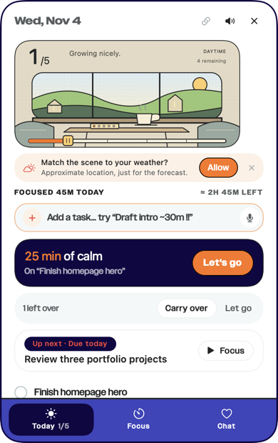
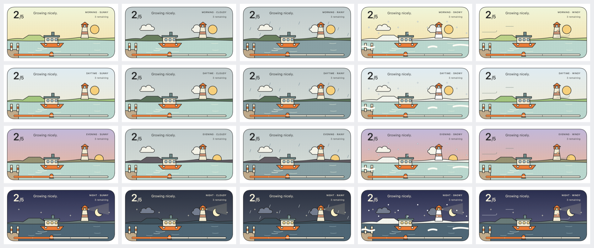
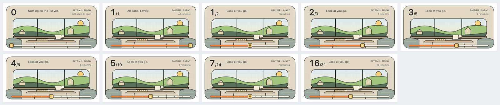

# Today's illustrated banners

The top of Today used to be the “little wins” meter (`SkyWinsCard`). Since 2026-11-04 it's an
illustrated banner: one of six little places Coco spends the day in, drawn in today's light and the
weather outside, with the day's progress along its rail. Coco now and then remarks on the weather
or the time of day in her speech bubble.

Source design: Figma Make file **Illustrated Task Card Concepts**
(`8qgFt7CDBmWWB55sQO6sAg`, round 04). Library: Coco-2 › *05 - Component Library* › section
**Sky — Banners (Today)**.

| # | Banner | `BannerID` | Make key |
|---|---|---|---|
| 03 | A Little Tidal Pool | `tidalPool` | `atmospheric` |
| 04 | Coco's Window Nook | `windowNook` | `coco` |
| 06 | The Slow Ferry | `slowFerry` | `ferry` |
| 07 | The Corner Bookshop | `cornerBookshop` | `bookshop` |
| 08 | Laundry in the Sky | `laundryInTheSky` | `rooftop` |
| 09 | The Quiet Carriage | `quietCarriage` | `train` |

## Where things live

| Piece | File | Job |
|---|---|---|
| Scene model | `Packages/BuddyKit/Sources/BuddyCore/Banners/SceneNode.swift` | SVG-shaped node tree; back to SVG (checks) and Figma-ready SVG |
| Art | `…/Banners/BannerArt.swift` | The six scenes, ported line for line from the Make file's `IllustratedScene.tsx` |
| Path data | `…/Banners/SVGPath.swift` | Parses `d` strings (all commands, arcs as Béziers) |
| Model | `…/Banners/BannerModel.swift` | `BannerID`, `BannerTimeOfDay`, `BannerWeather`, `BannerState`, `BannerProgress` |
| Rotation & clock | `…/Banners/BannerSchedule.swift` | `DailyBannerRotation`, `BannerClock` |
| Weather model | `…/Banners/Weather.swift` | `WeatherCondition`, `WeatherSnapshot` (+ mapping to the art), `TemperatureText` |
| Remarks | `…/Banners/BannerComments.swift` | `BannerCommentEngine`, `BannerCommentPacing`, `BannerLines` (the copy) |
| Forecast parsing | `Packages/BuddyKit/Sources/BuddyIntegrations/METNorway.swift` | MET Norway request + response → `WeatherSnapshot` |
| Layers | `DesktopBuddy/Banner/BannerLayerBuilder.swift` | Scene tree → Core Animation layers, SVG rules |
| Motion | `DesktopBuddy/Banner/BannerMotion.swift` | Ambient loops and progress slides (the Make file's CSS) |
| View | `DesktopBuddy/Banner/BannerSceneView.swift` | Hosts the layers, crossfades between states |
| Card | `DesktopBuddy/Banner/IllustratedBannerView.swift` | SwiftUI card: art + text, accessibility |
| Day & light | `DesktopBuddy/Banner/DailyBannerManager.swift` | Today's banner and light; day change, wake, clock and time-zone changes |
| Weather offer | `DesktopBuddy/Banner/BannerWeatherOffer.swift` | The one-time offer under the banner |
| Weather service | `DesktopBuddy/Services/Weather/` | `WeatherProvider` protocol, `METNorwayProvider`, `MockWeatherProvider` (Debug), `LocationProvider`, `WeatherStore` |
| Wiring | `AppModel` (`bannerState`, `remarkOnTheDay`, weather in `get_today`), `TodayView.summary`, Settings › Weather |
| Reference SVG | `design/banners/states/<bannerID>/<time>-<weather>.svg` (2 of 5 done) and `…/progress/daytime-sunny-<n>of5.svg` |
| Make source | `design/banners/make-source/IllustratedScene.tsx`, `motion.css` |

The banner logic, weather logic, remark selection and motion are all outside the task list UI;
`TodayView` only places `IllustratedBannerView` and `BannerWeatherOffer`.

## The art: what was imported, and how it stays true

The Make file's illustrations aren't image files. Each scene is vector code — SVG paths, colours
and rules in `IllustratedScene.tsx` — that redraws itself for four lights (Morning, Daytime,
Evening, Night), five weathers (Sunny, Cloudy, Rainy, Snowy, Windy) and the progress. So
“importing every state” means importing that code:

- **Ported exactly.** `BannerArt` is the TSX transliterated into Swift, with the same path data,
  colours, stroke widths, caps and joins, layer order, clip paths, gradient and stippling.
- **Checked against the original for every state.** `scripts/banners/export_make_states.sh` renders
  the Make file's own TSX (React, in Node) to SVG for all 6 × 4 × 5 = 120 light/weather states and
  every step of 0–5 done. `BannerArtPortTests` compares each one with `BannerArt`, element by element
  and attribute by attribute (numbers compared as numbers). All 156 match.
- **Drawn as vectors.** `BannerLayerBuilder` builds every path straight into points at the card's
  size, so line art is rendered at screen resolution, never scaled from a bitmap, and stroke weights
  scale exactly with the art. Pixel comparison of the app's layers with Chrome's render of the
  original SVG (all 120 states, 640 × 304 px): mean difference under 1/255 per pixel, at most 0.05% of
  pixels visibly different (anti-aliasing at edges).
- **Every state the Make file has, no more.** There is no storm, fog or sleet art in the file, so
  those use the closest drawn weather (below). Nothing was redrawn or invented.

To change the art: edit it in the Make file, copy its new `src/IllustratedScene.tsx` into
`design/banners/make-source/`, run `scripts/banners/export_make_states.sh`, then update
`BannerArt.swift` until `swift test --filter BannerArtPortTests` passes. Re-run
`--banner-snapshots` and re-import `figma/` into the library (see Figma below).

**Naming.** Figma `Banner/Art/<NN> <Title>` with variants `Time of day=<Morning|Daytime|Evening|Night>,
Weather=<Sunny|Cloudy|Rainy|Snowy|Windy>` ↔ Swift `BannerID.<id>`, `BannerTimeOfDay.<morning…>`,
`BannerWeather.<sunny…>` ↔ files `<bannerID>/<time>-<weather>.svg`. Moving layers are named after the
Make file's CSS classes (`vector-cloud`, `ferry-bob`…; `BannerArt.Motion`).

## Daily rotation

- One banner a day, the same all day however often Coco is opened.
- Every banner shows once per round of six before any comes round again, and never the same one two
  days running.
- Days are counted in the user's own calendar and time zone, from a fixed epoch (2026-11-02), so the
  banner changes at their midnight.
- The order inside each round is a shuffle seeded by the round number (SplitMix64) — it reads as a
  fresh sequence, yet it's the same on every launch and every Mac. Nothing random at runtime.
- It updates without a restart: at midnight (`NSCalendarDayChanged`), after waking, when the clock or
  time zone changes, and when the panel opens.
- **Adding a banner:** add a `BannerID` case, its art in `BannerArt` (and a test reference). It joins
  the rotation automatically; future days reshuffle.

## Time of day

Local clock, no location needed: **Morning 5:00–11:00 · Daytime 11:00–17:00 · Evening 17:00–21:00 ·
Night 21:00–5:00** (`BannerClock`). A timer fires at the next boundary and is re-armed after every
check; the light is also re-checked after sleep. “Daytime” is the Make file's word for the afternoon
light.

## Weather

**Off until the user turns it on** — the offer under the banner (“Match the scene to your weather?”
→ *Allow*), or Settings › Weather. Turning it on asks macOS for location with
`kCLLocationAccuracyReduced` (a few kilometres). Users can type a town instead (Apple geocoding,
no location permission). The usage string explains why.

**Provider:** MET Norway Locationforecast 2.0 (`api.met.no`): free worldwide, no key, CC BY 4.0,
commercial use allowed. Their terms are kept: identifying User-Agent (app + support URL),
coordinates rounded (we use 2 decimals ≈ 1 km), no request before the previous `Expires`,
`If-Modified-Since` for repeats. Swapping providers = one new `WeatherProvider` conformance; the
banner, remarks and Settings only see `WeatherSnapshot`.

**Caching and refresh.** The whole forecast (days ahead) is saved to Application Support
(`weather-forecast.json`) and read hour by hour, so the network is asked only when needed:
reading 45+ min old (checked every 15 min), after waking if 20+ min old, when the panel opens on a
stale reading, and never before `Expires`. Failures back off 5 / 15 / 30 min. The last location fix is
reused for 3 h (re-read after wake). Stale after 90 min (corner label at 60 %, still shown);
unusable after 6 h.

**Weather → art** (`WeatherSnapshot.bannerWeather`):

| Real weather | Art | Note |
|---|---|---|
| Clear | Sunny | At night the art has the moon and stars, no sun |
| Clear or partly cloudy, wind ≥ 8 m/s | Windy | Windy art = the clear scene + gusts |
| Partly cloudy, cloudy | Cloudy | The cloudy art keeps a soft sun |
| Fog | Cloudy | Fallback: no fog art |
| Drizzle, rain, heavy rain | Rainy | |
| Thunderstorms | Rainy | Fallback: no storm art |
| Sleet | Snowy at ≤ 1 °C, else Rainy | Fallback: no sleet art |
| Snow | Snowy | |
| No weather (off, denied, offline > 6 h) | Sunny (plain) | Corner shows only the light; no weather talk |

The corner says the real condition where the art approximates it (DRIZZLE, FOGGY, THUNDERSTORMS…)
and the temperature in the user's unit from macOS (`Measurement…usage: .weather`; °F or °C).

**States** (Banner/Card): *Ready* · *Looking outside* (first look-up) · *Stale* · *No weather* ·
*No tasks*. Settings › Weather also shows *Waiting for location access*, *Location access is off*
(with a button to Location Services and the city field), and *Couldn't update: <reason>*.

**The chat** knows too: `get_today` ends with a weather line (condition, temperature in the user's
unit, wind, next 6 h, rest-of-day range, how old it is), or says weather is off.

**Debug/testing only:** `MockWeatherProvider`, and launch arguments `--banner <id>`,
`--banner-time <morning|daytime|evening|night>`, `--banner-weather <sunny|cloudy|rainy|snowy|windy>`
pin what's shown (they never run in Release).

## Coco's remarks

`BannerCommentEngine` picks a topic from what the banner shows — rain now, rain coming (only when
the forecast says so), snow, storm, wind, fog, gloom, cold/chilly/warm/hot (with clothing or water
suggestions), clear mornings/days/evenings/nights, winding down, late night, and lines about today's
scene — avoiding recent topics and lines. With no weather it sticks to the time and the place. Lines
never contradict the art: rain lines need rainy art, sun lines need daylight and clear art.

`BannerCommentPacing` keeps it rare and never repeats on restart (saved in preferences): at most once
per part of the day, at least 90 min apart, sooner (40 min) only when rain or snow starts. It obeys
the same manners as her other chatter (`AppModel.chatterTick`): not during focus, a meeting or voice
input, not with the panel open, not while away, not over another line, only in Interactive presence,
and it's switched off with “Coco chats now and then”. Lines fit her bubble (≤ 72 characters; a test
checks).

**Editing the copy:** everything is in `BannerLines` — plain strings per topic and per scene.

## Any number of tasks

The prototype was built for five (`x = 20 + done * 56`). Now everything is a share of the rail
(`BannerProgress`):

- Thumb, fill and ferry move by `done / total` (in units: thumb 20 + 280 × share, ferry 35 + 160 ×
  share, the nook's ball 211 + 25 × share). With five tasks this is exactly the prototype.
- One tick per task, the last at the end; above 30 tasks the rail is smooth (no ticks).
- Art drawn with five slots of its own — the bookshop's windows, the laundry, the ticket punches, the
  nook's plant — lights each slot once that fifth of the day is done.
- The count grows to the right and pushes Coco's note along; the note gives way to the corner column
  (`BannerTextLayout`). Checked at 0, 1, 2, 3, 5, 8, 10, 14, 31 and up to 100 (tests).
- 0 tasks: “0”, “Nothing on the list yet.”, “Add a task to begin”.
- The card is always 320 : 152 — its height never depends on the task count, so adding or completing
  tasks never moves the layout. Art and text scale together with the width (checked 280–480 pt).

## Motion

From the Make file's CSS (`design/banners/make-source/motion.css`), played by Core Animation in
the window server (`BannerMotion`):

| Class | What | Values (art units) | Time | Easing |
|---|---|---|---|---|
| vector-cloud | clouds | x 0 → 7, back | 9 s | ease-in-out |
| vector-star | stars at night | opacity .2 → 1, scale .7 → 1.1, back | 3 s | ease-in-out |
| vector-rainfall | rain | (3, −10) → (−3, 25); opacity 0 → .7 (25 %) → 0 | 1.2 s, loops | linear |
| vector-snowfall | snow | (−2, −4) → (8, 42); opacity .1 → .9 (30 %) → 0 | 4 s, loops | ease-in-out |
| vector-gust | wind lines | x 0 → 7, back | 3 s | ease-in-out |
| vector-sway | the nook's plant (windy) | rotate 0 → 4° about its base, back | 2.5 s | ease-in-out |
| hanging-linen | laundry (windy) | rotate 0 → 6° from the peg, back | 3 s | ease-in-out |
| ferry-bob | the ferry | y 0 → 1.5 → 0 | 4 s | ease-in-out |
| carriage-scenery | houses past the window | x 0 → −7, back | 9 s | ease-in-out |
| tea-steam | steam | opacity .15 → .7 → .15; y 0 → −2 → 0 | 3 s | ease-in-out |
| vector-thumb | rail thumb | slides to the new share | 0.35 s | cubic-bezier(.2,.8,.2,1) |
| ferry-journey | the crossing | slides to the new share | 0.6 s | cubic-bezier(.2,.8,.2,1) |

- A new light, weather or banner crossfades the whole scene over 1.2 s; a task done crossfades the
  lit window / laundry / punch over 0.35 s while the thumb slides. Old and new frames slide together
  and share one clock for their loops, so nothing ghosts, jumps or fights.
- Reduce Motion: no ambient loops and no sliding; crossfades only.
- One deliberate difference: stars twinkle about their own centres. The Make file scaled them about
  the SVG origin (the CSS default for SVG), which slid them across the sky.
- Energy (Release, 2026-11-04, panel open): the app uses 0.36–0.53 % of one core with or without the
  ambient loops (A/B with `-DBANNER_STATIC`, `scripts/energy-check.sh`); no measurable WindowServer
  difference. Loops are capped at 30 fps.

## Verifying

| Check | How |
|---|---|
| Port fidelity, 156 states | `swift test --filter BannerArtPortTests` (Packages/BuddyKit) |
| Rotation, clock, progress, weather mapping, remarks, pacing, MET parsing | `swift test` (Packages/BuddyKit) |
| Live view: slides, crossfades, rapid changes, day rollover, weather states, remark pacing (36 checks) | `DesktopBuddy --banner-selftest` (unsandboxed Debug); add `--live` for one real MET forecast |
| Every state as cards, sheets, task counts, widths, captions; art PNGs; SVG; Figma SVG | `DesktopBuddy --banner-snapshots <dir>` |
| The panel | `SNAPSHOT_ONLY=panel-today DesktopBuddy --snapshots <dir>` |
| Energy | `scripts/energy-check.sh` (instructions at its top) |

## Figma

Coco-2 › *05 - Component Library* › **Sky — Banners (Today)**:

- `Banner/Art/<NN> <Title>` × 6 — Time of day × Weather (20 variants each), imported from the app's
  own export (`--banner-snapshots …/figma/`), at 2 of 5 done, 350 × 166.
- `Banner/Card` — State (Ready, Looking outside, Stale, No weather, No tasks); text properties Done,
  Total, Note, Light & weather, Remaining; instance swap **Scene** (the six art sets, with Time of
  day and Weather exposed); variable collection **Banner** (Day/Night) for the text colour.
- `Banner/Weather Offer` — Kind = Offer, Location off.
- `Banner/Remark Bubble` — Shown (comment visibility), Remark.
- `Icon/cloud.sun`, `Icon/location.slash`; text styles `Sky/Banner/*` (also in `design/tokens.json` →
  `SkyType.banner…`).
- **Banners — how they work**: the rules above, with renders from the app.
- **Banner motion — The Slow Ferry, rainy** (beside the section): clouds, rain and ferry bob as
  native Figma keyframes, matching the code (read back with `get_motion_context`). Figma can't
  keyframe layers inside instances, so this is a detached copy.
- `Today/WinsCard` is marked retired; its 13 instances on *01 - Coco Screens* are now `Banner/Card`.

**Code Connect** can't be used on this file (it needs an Organization or Enterprise plan; refused
again on 2026-11-04). The mapping is in `design/figma-map.json` — check it with
`python3 scripts/tokens/check_figma_map.py`. The Figma components aren't live-linked to the code:
when the art changes, re-run the snapshots and re-import.

## Known limits

- The Figma art components are drawn at 2 of 5 done; in the app the rail follows the real list.
- The Window Nook's cushion is empty, as in the Make file (its note asks for Coco's own artwork
  rather than a stand-in dog).
- Location is approximate by design; a typed town is used as given.
